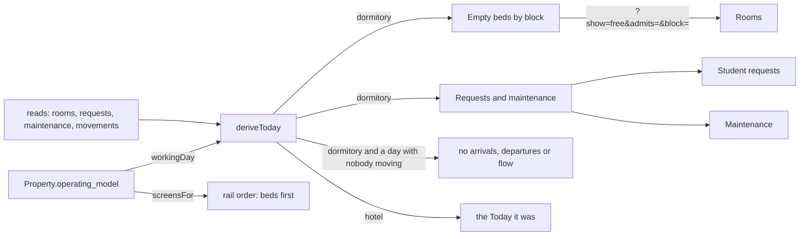

# Today at a dormitory

What the manager of a student dormitory reads on Today (RANZ-108, rows
`TD-S10-01` to `TD-S10-12` in [`edge-cases.csv`](edge-cases.csv)). The hotel's
Today is unchanged: every difference below is chosen by the Property's
operating model as a default, never as a rule (ADR 0057), and nothing in SQL
reads it.

## Decisions taken while designing

No person was available to grill, so each question carries the recommendation
built on. All rows are `proposed`.

1. **Does the open work card sit beside the hotel's Maintenance card or replace
   it?** Replace it at a dormitory. The same open and in-hand counts would
   otherwise be drawn twice under two names. Common sense for the reader; no
   comparable system was checked (TD-S10-05).
2. **Is the maintenance figure "Faults"?** No: it counts every open
   maintenance request, faults and service work alike, so it is called
   Maintenance. A faults-only count is deferred until the category is a
   defined set (TD-S10-11).
3. **Does a dormitory have a mode that turns the bed figures on?** No. Bed
   counts follow whether beds exist (`byBed`), so a hotel that lets by the bed
   gets them too; only the words and the default cards follow the operating
   model (TD-S10-07, ADR 0057).
4. **What does `?block=` look like?** The building's name; `none` for rooms in
   no building; absent for the whole house. An unknown name narrows nothing
   rather than showing an empty list that reads as "no beds free". Carried by
   the awkward case (a renamed or removed building), not by a comparable
   system (TD-S10-02, TD-S10-03).
5. **Is the day with nobody arriving drawn as 0/0?** No at a dormitory, which
   is quiet most days; the figures return the moment somebody is due. A
   section that failed to read is never treated as quiet. A hotel keeps them:
   an empty arrivals list is news at a front desk. Carried by the dormitory's quiet days, not by a
   comparable system (TD-S10-06).
6. **Where do arrivals and departures hide?** On the timeline and the
   overview only, where they are figures and a flow. The house, next-up and
   night layouts list the arrivals and departures themselves as rows under
   their own lead question and are unchanged; the empty-beds and open-work
   cards were added beneath them (TD-S10-06, TD-S10-08).
7. **Does the rail change for a dormitory?** Order only. The beds, calendar and
   reservations come first, Close the day moves among the building's work. The
   set of pages and each page's gate are identical to a hotel's (ADR 0056,
   TD-S10-09).
8. **Overdue instalments?** Not on this lane's Today: the instalments module
   decides what overdue means (TD-S10-12).
